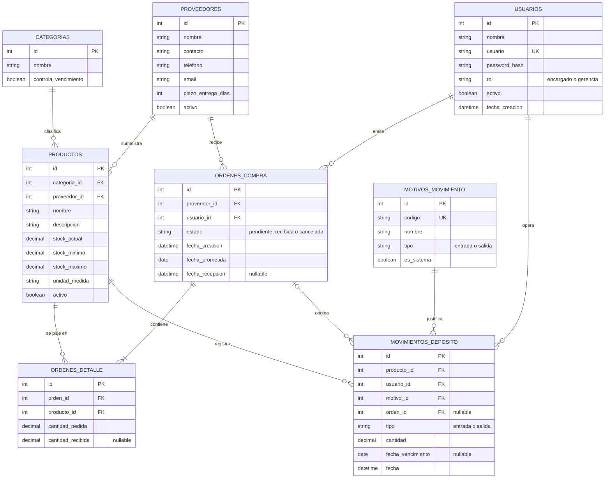

# Plan de Implementación: Sistema de Gestión de Compras y Depósito - CATástrofe Petshop

Sistema interno de gestión para el área de **Compras y Depósito** de CATástrofe Petshop, diseñado para la cátedra de Trabajo Práctico. El objetivo es reemplazar controles manuales por una plataforma web segura, clara y fácil de estudiar y defender, construida con **HTML, CSS (Vanilla), JavaScript (Vanilla), PHP y MySQL**.

---

## 1. Justificación de Entorno: XAMPP vs MySQL Workbench

> **Elección: XAMPP**
> - **MySQL Workbench** es únicamente un cliente visual para hacer consultas SQL. No incluye servidor web ni intérprete de PHP.
> - **XAMPP** es un paquete integral que levanta en un solo clic **Apache** (servidor web que procesa PHP), **MySQL / MariaDB** (motor de base de datos) y **phpMyAdmin** (administrador visual de la base desde el navegador).

### Ubicación y configuración

- **Carpeta del proyecto:** `C:\xampp\htdocs\catastrofe\`, accesible en `http://localhost/catastrofe/`. Por defecto Apache solo sirve lo que está dentro de `htdocs`. El nombre va en minúsculas y sin tildes para evitar problemas en URLs y rutas; "CATástrofe" queda como título visible del sistema.
- **Base de datos:** `catastrofe_db`, motor **InnoDB** (necesario para claves foráneas y transacciones) y cotejamiento `utf8mb4_unicode_ci` (tildes y ñ).
- **Versiones:** XAMPP actual (PHP 8.x y MariaDB 10.4 o superior). Los `CHECK` se aplican desde MariaDB 10.2 y MySQL 8.0.16.
- **Zona horaria:** `America/Argentina/Buenos_Aires`, fijada en `config/db.php`.
- **Usuario `root` sin contraseña:** aceptable solo en este entorno local de desarrollo.

---

## 2. Arquitectura del Proyecto y Filosofía de Código

Dado que el código debe ser **fácil de comprender y estudiar** para la defensa:

- **Sin frameworks pesados**: CSS puro organizado con variables CSS (fácil de modificar) y JavaScript Vanilla directo, sin herramientas de compilación (sin Webpack, Vite ni npm).
- **Arquitectura PHP modular de páginas tradicionales**:
  - Conexión centralizada con PDO (modo excepciones) en `config/db.php`, que también define la zona horaria, los datos de conexión, el modo depuración (`APP_DEBUG`) y `BASE_URL` (se detecta sola a partir de la carpeta donde está instalado el sistema).
  - Cabecera, menú lateral y pie reutilizables (`header.php`, `sidebar.php`, `footer.php`).
  - Sesiones nativas de PHP (`session_start()`): cada vista y cada acción verifican sesión y rol.
  - Todos los `require` usan `__DIR__`, para no depender del directorio desde el que se ejecuta el script.
  - Nombres en español y en `snake_case` para tablas, columnas y funciones.
- **Patrón único para cada acción (`api/accion_*.php`)**, siempre en el mismo orden (fácil de explicar en la defensa):
  1. Verificar sesión y rol (`requerir_encargado()`).
  2. Verificar el token CSRF.
  3. Validar los datos recibidos: tipos, rangos y pertenencia (por ejemplo, que el producto sea del proveedor elegido).
  4. Ejecutar consultas preparadas, dentro de una **transacción** cuando se modifica más de una tabla.
  5. Guardar un mensaje en sesión y redirigir (patrón *Post/Redirect/Get*, que evita reenvíos al refrescar).
- **Paleta visual**:
  - Color base / neutro: Blanco cálido y gris suave.
  - Primario (Identidad y balance): Turquesa profundo (`#0d9488` / `#14b8a6`) y Verde bosque suave (`#10b981`).
  - Acento y llamadas a la acción: Magenta vibrante (`#d946ef` / `#c026d3`).
  - Contraste y navegación: Azul pizarra (`#1e293b` / `#0f172a`).

---

## 3. Modelo de Base de Datos Relacional (MySQL)

Se diseñará un script `database.sql` (estructura, restricciones y datos de prueba) para importar en phpMyAdmin con las siguientes tablas:



### Detalle de Tablas

| Tabla | Propósito | Reglas clave |
|---|---|---|
| `usuarios` | Cuentas de acceso | `rol` es `encargado` o `gerencia`. `activo` (baja lógica: un usuario inactivo no puede ingresar y pierde la sesión abierta). La contraseña se guarda con `password_hash()` (columna `password_hash`, 255 caracteres). `database.sql` carga 2 usuarios de demo, uno por rol. |
| `categorias` | Alimento, arena, accesorios, higiene, juguetes | `controla_vencimiento` = 1 en alimento e higiene. Lista fija cargada por SQL. |
| `proveedores` | Ficha técnica del proveedor | `plazo_entrega_dias` (plazo habitual de entrega) y `activo` (baja lógica). |
| `productos` | Catálogo y control de stock | `stock_minimo`, `stock_maximo` y `stock_actual`. Un proveedor habitual por producto. `activo` (baja lógica). |
| `ordenes_compra` | Cabecera de un pedido a un proveedor | Estados `pendiente`, `recibida` y `cancelada`. `fecha_prometida` = fecha de emisión + plazo del proveedor, guardada al emitir (no cambia si después se modifica el plazo). |
| `ordenes_detalle` | Líneas del pedido (un producto por línea) | `cantidad_pedida` > 0. `cantidad_recibida` queda en NULL hasta la recepción y va de 0 a lo pedido. Único por (`orden_id`, `producto_id`). |
| `motivos_movimiento` | Lista controlada de motivos | Cada motivo es de tipo `entrada` o `salida`. `es_sistema` = 1 marca los que registra el sistema solo (recepción de orden y stock inicial); no aparecen en el formulario manual. |
| `movimientos_deposito` | Historial de entradas y salidas | Inmutable: nunca se edita ni se borra. `orden_id` enlaza cada recepción con su orden. `fecha_vencimiento` solo se carga en entradas de categorías que controlan vencimiento: cada una de esas entradas es un **lote**. |

**Motivos cargados:**
- Entradas: Recepción de orden de compra (sistema), Stock inicial (sistema), Devolución de cliente, Ajuste de inventario (+).
- Salidas: Venta, Consumo en guardería, Consumo en peluquería, Producto dañado, Producto vencido, Ajuste de inventario (-).

### Reglas de Integridad

- **Claves foráneas con `ON DELETE RESTRICT`:** nada se borra si tiene historial. Productos y proveedores se **dan de baja** (`activo = 0`): dejan de aparecer en listados y selectores, pero su historial se conserva.
- **`CHECK` en la base de datos** como red de seguridad: `stock_actual >= 0`, `stock_minimo >= 0`, `stock_maximo >= stock_minimo` y cantidades de pedidos y movimientos `> 0`. La validación principal se hace en PHP.
- **`stock_actual` es un valor derivado:** solo cambia junto con un movimiento y dentro de la misma transacción. Invariante: `stock_actual = Σ entradas − Σ salidas` (hay una consulta de control en la sección 8).

### Datos de Prueba

`database.sql` carga datos suficientes para demostrar todo el sistema sin cargar nada a mano:
- 40 productos de las 5 categorías, con productos en estado crítico, próximo a agotarse y normal (uno de ellos se vende por kg, con stock decimal).
- 4 proveedores con desempeños distintos (de ~87 % de entregas a tiempo a ~14 %), para que el reporte de cumplimiento muestre diferencias.
- 165 órdenes de compra a lo largo de ~5 meses, con fechas relativas al día de la importación: 144 recibidas (a tiempo, adelantadas, con demora y con líneas incompletas), 8 pendientes (4 ya demoradas) y 13 canceladas. Más de 400 líneas de detalle.
- Más de 2.500 movimientos de entrada y salida (recepciones de órdenes, ventas, consumos, devoluciones, ajustes, productos dañados y vencidos) con los que se calcula el stock cargado, así el invariante se cumple desde el primer momento. Incluyen un lote vencido y lotes por vencer en 30, 60 y 90 días.
- Los datos masivos son de prueba (no reflejan un uso real) y se generan con fechas relativas, así que siempre se ven "recientes" sin importar cuándo se importe el script.
- 2 usuarios de demo (`encargado` y `gerencia`). Las contraseñas ya vienen hasheadas en el script y se indican en `README.md`; para cambiarlas se genera un hash nuevo con `C:\xampp\php\php.exe -r "echo password_hash('clave', PASSWORD_DEFAULT);"`.

---

## 4. Estructura de Carpetas del Proyecto

```
C:\xampp\htdocs\catastrofe\
│
├── index.php                   # Punto de entrada: redirige a login o dashboard según la sesión
├── database.sql                # Estructura, restricciones y datos de prueba (importar en phpMyAdmin)
├── README.md                    # Instalación, usuarios de demo y guion de demostración
│
├── config/
│   └── db.php                  # Configuración (BASE_URL, zona horaria, APP_DEBUG) y conexión PDO
│
├── includes/
│   ├── auth.php                # Sesión, control de rol (requerir_login / requerir_encargado / requerir_gerencia) y token CSRF
│   ├── funciones.php           # Helpers (e(), estado_stock(), cantidad_sugerida(), mensajes) y operaciones de stock (registrar_entrada / registrar_salida)
│   ├── header.php              # Apertura HTML, estilos y barra superior
│   ├── sidebar.php             # Menú lateral dinámico según rol
│   └── footer.php              # Cierre de HTML y scripts generales
│
├── assets/
│   ├── css/
│   │   └── style.css           # Estilos con CSS Variables (turquesa, verde, magenta, azul)
│   └── js/
│       ├── main.js             # Mensajes, confirmaciones, diálogos y formularios dinámicos
│       ├── filtros.js          # Búsqueda y filtrado dinámico en tablas sin recargar
│       └── reportes.js         # Totales de los reportes 1 y 2, recalculados al filtrar
│
├── views/                      # Pantallas del sistema
│   ├── login.php               # Pantalla de acceso
│   ├── logout.php              # Cierre de sesión
│   ├── dashboard.php           # Resumen general (KPIs y alertas)
│   ├── stock.php               # Listado de productos, alertas visuales y ABM
│   ├── proveedores.php         # Gestión y fichas de proveedores
│   ├── ordenes.php             # Listado de órdenes, recepción y cancelación
│   ├── orden_nueva.php         # Emisión de órdenes con cantidades sugeridas
│   ├── movimientos.php         # Registro e historial de entradas y salidas
│   ├── reportes.php            # Tablas dinámicas (compras, proveedores, vencimientos)
│   ├── usuarios.php            # Gestión de usuarios (solo Gerencia)
│   └── perfil.php              # Mi perfil: cada persona edita su propia cuenta
│
└── api/                        # Acciones PHP que procesan formularios (POST)
    ├── accion_login.php
    ├── accion_producto.php
    ├── accion_proveedor.php
    ├── accion_movimiento.php
    ├── accion_orden.php
    ├── accion_usuario.php      # Alta, edición y baja de usuarios (solo Gerencia)
    └── accion_perfil.php       # Edición de la propia cuenta (cualquier rol)
```

---

## 5. Módulos y Flujos Funcionales

### A. Autenticación, Roles y Seguridad

- Pantalla `login.php` estilizada con la estética de CATástrofe Petshop. `accion_login.php` busca el usuario con una consulta preparada, valida con `password_verify()`, llama a `session_regenerate_id(true)` y guarda `$_SESSION['usuario_id']`, `$_SESSION['nombre']` y `$_SESSION['rol']`. Ante un error muestra un mensaje genérico ("Usuario o contraseña incorrectos"), sin indicar cuál de los dos falló.
- **Permisos por rol:**

| Funcionalidad | Encargado | Gerencia |
|---|:---:|:---:|
| Ver dashboard, stock, proveedores, órdenes y movimientos | Sí | Sí (solo lectura) |
| Ver reportes | Sí | Sí |
| Crear, editar y dar de baja productos y proveedores | Sí | No |
| Registrar movimientos de depósito | Sí | No |
| Emitir, recibir y cancelar órdenes de compra | Sí | No |
| Gestionar usuarios (alta, edición, baja, roles) | No | Sí |
| Editar el propio perfil (nombre, usuario, contraseña) | Sí | Sí |

- **Reportes:** los ven ambos roles (el Encargado los necesita para decidir compras); en el menú de Gerencia aparecen primero.
- **Auditoría:** el historial de `movimientos.php` (quién, qué, cuándo, motivo y orden asociada) es la traza de auditoría, visible para ambos roles. No hay un módulo aparte.
- **Tres capas de control:**
  1. La interfaz oculta los botones y formularios que el rol no puede usar (comodidad).
  2. `requerir_login()`, `requerir_encargado()` o `requerir_gerencia()` al inicio de cada vista y de cada `api/accion_*.php` (los usuarios solo los gestiona Gerencia; `perfil.php` y `accion_perfil.php` piden solo sesión y operan siempre sobre la cuenta de la sesión). Es la barrera real: ocultar un botón no es seguridad.
  3. Token CSRF en todos los formularios, verificado con `hash_equals()` en cada acción.
- **Lista de seguridad aplicada en todo el código:**
  - Contraseñas con `password_hash()` y `password_verify()`; nunca en texto plano.
  - Consultas preparadas de PDO para todo dato que venga del usuario (sin concatenar variables en el SQL).
  - Todo dato que se muestra pasa por `e()` (`htmlspecialchars(..., ENT_QUOTES, 'UTF-8')`).
  - Cookie de sesión con `httponly` y `samesite=Lax`; `logout.php` destruye la sesión.
  - Los errores de base de datos no se muestran al usuario: mensaje genérico y detalle en el log de PHP. El detalle técnico en pantalla solo aparece con `APP_DEBUG` activo, que se desactiva para la entrega.

### B. Módulo de Stock y Alertas Visuales

- Tabla con código de color por fila (helper `estado_stock()`):
  - **Rojo/Magenta suave:** `stock_actual <= stock_minimo` (alerta crítica).
  - **Amarillo/Naranja suave:** `stock_actual <= stock_minimo * 1.2` (próximo a agotarse).
  - **Verde:** stock normal.
- Columna **En pedido:** suma de `cantidad_pedida` de ese producto en órdenes `pendiente`.
- **Cantidad sugerida** = `stock_maximo - stock_actual - en_pedido` (si da 0 o menos, no hay sugerencia). Descontar lo ya pedido evita generar órdenes duplicadas.
- En las filas críticas o próximas a agotarse con sugerencia, botón **"Generar Orden Sugerida"**: abre `orden_nueva.php` con el proveedor del producto elegido y el producto ya marcado. Si ya hay un pedido que cubre la necesidad, se muestra la etiqueta "Pedido en curso" en lugar del botón.
- **Alta de producto:** el formulario (un `<dialog>`) incluye el *stock inicial*. El producto se crea con `stock_actual = 0` y, si el stock inicial es mayor a 0, se registra una entrada con motivo "Stock inicial" en la misma transacción (con fecha de vencimiento si la categoría la controla).
- **Edición:** el formulario no incluye `stock_actual`. Para corregir el stock se registra un movimiento de ajuste.
- **Baja:** con confirmación en JavaScript; marca `activo = 0` y conserva el historial.
- Filtros en tiempo real (texto, categoría y estado) con `filtros.js`.

### C. Módulo de Órdenes de Compra

- **Emisión (`orden_nueva.php`):**
  1. El Encargado elige el proveedor; la página se recarga con los productos activos de ese proveedor.
  2. Cada producto muestra stock actual, mínimo, máximo, "en pedido" y la cantidad sugerida, que se puede editar. Los productos en alerta vienen marcados.
  3. Al confirmar, `accion_orden.php` valida (cantidades mayores a 0, productos del proveedor elegido, sin repetidos) y, en una transacción, crea la cabecera (`pendiente`, con su `fecha_prometida`) y las líneas.
- **Listado (`ordenes.php`):** pestañas Pendientes / Recibidas / Canceladas, con el detalle de líneas de cada orden. Las pendientes cuya `fecha_prometida` ya pasó se resaltan como demoradas.
- **"Confirmar Recepción de Mercadería":** abre un `<dialog>` con una fila por producto: cantidad recibida (por defecto, la pedida) y, si la categoría controla vencimiento, la fecha de vencimiento del lote. Debe haber al menos una línea con cantidad mayor a 0; si no llegó nada, se cancela la orden. `accion_orden.php` hace todo en **una única transacción** (si algo falla se hace `rollBack()` y no queda nada a medias):
  1. Pasa la orden a `recibida` y registra `fecha_recepcion` con `UPDATE ... WHERE id = ? AND estado = 'pendiente'`, verificando que afectó una fila (así un doble clic no recibe la mercadería dos veces).
  2. Guarda `cantidad_recibida` en cada línea.
  3. Por cada línea con cantidad recibida mayor a 0, registra un movimiento de **entrada** (motivo "Recepción de orden de compra", con `orden_id` y el vencimiento si corresponde) y suma esa cantidad al `stock_actual`.
- **La recepción cierra la orden.** Si el proveedor entregó de menos, la diferencia queda registrada (`cantidad_recibida < cantidad_pedida`) y, si el producto sigue bajo el mínimo, vuelve a aparecer con cantidad sugerida.
- **Cancelar:** solo órdenes pendientes, con confirmación. No modifica el stock.

### D. Módulo de Movimientos de Depósito

- Formulario: producto, tipo (entrada o salida), motivo, cantidad y, solo en entradas de categorías que controlan vencimiento, la fecha de vencimiento (obligatoria). La lista de motivos se filtra por tipo con JavaScript y no incluye los motivos de sistema.
- **Una salida no puede dejar el stock en negativo.** El servidor ejecuta `UPDATE productos SET stock_actual = stock_actual - ? WHERE id = ? AND stock_actual >= ?` y comprueba que afectó una fila; recién entonces registra el movimiento (misma transacción). El JavaScript avisa antes de enviar, pero la validación real es la del servidor.
- Historial con filtros en tiempo real (texto, tipo y fechas). Los movimientos no se editan ni se borran: un error se corrige con un movimiento de ajuste.

### E. Módulo de Reportes (Tablas Dinámicas con Filtros en JS)

Los filtros funcionan en tiempo real, sin recargar la página (el volumen de datos de un TP lo permite): buscador de texto, categoría y rango de fechas (el rango aplica a los reportes 1 y 2; el 3 se filtra por ventana de vencimiento). En los reportes 1 y 2 el servidor entrega los datos en JSON y `reportes.js` recalcula los totales cada vez que cambia un filtro; el reporte 3 usa el filtrado de filas de `filtros.js`.

1. **Productos más comprados:** por producto, suma de `cantidad_recibida` de las órdenes `recibida` dentro del rango (según fecha de recepción), junto a la cantidad pedida; ordenado de mayor a menor.
2. **Cumplimiento de proveedores:** por cada orden recibida compara `fecha_prometida` con `fecha_recepcion` (días de demora). Por proveedor resume el porcentaje de entregas a tiempo, la demora promedio (las entregas a tiempo cuentan como 0 días) y el porcentaje de líneas entregadas completas (se mide por líneas y no por cantidades, porque los productos tienen unidades distintas).
3. **Control de vencimientos:** trabaja con los lotes (entradas con fecha de vencimiento). Como las salidas no descuentan por lote, el stock actual se asigna a los lotes más recientes (**PEPS**: lo primero en entrar es lo primero en salir). Por lote muestra la cantidad estimada en depósito, la fecha de vencimiento y los días restantes, clasificados en **Vencido**, **hasta 30 días**, **hasta 60 días** y **hasta 90 días**. Es una estimación y la pantalla lo aclara.

### F. Dashboard

Resumen general: productos en estado crítico y próximos a agotarse, órdenes pendientes (y cuántas están demoradas), lotes vencidos o que vencen en los próximos 30 días y los últimos 5 movimientos. Gerencia ve lo mismo, sin botones de acción.

---

## 6. Decisiones de Diseño y Límites Conocidos (para la defensa)

| Decisión | Por qué | Límite conocido |
|---|---|---|
| Orden de compra = cabecera + detalle | Una orden por proveedor con varios productos, como un pedido real. La base queda normalizada y sin datos repetidos. | Cada producto tiene un solo proveedor habitual. |
| `stock_actual` guardado en `productos` | Consultar el stock es inmediato; no hay que sumar todo el historial en cada pantalla. | Podría desincronizarse si alguien lo modifica a mano. Por eso solo cambia junto con un movimiento, en una transacción, y existe una consulta de control. |
| Movimientos inmutables y ajustes | Trazabilidad completa y auditoría confiable. | Corregir un error exige registrar un movimiento de ajuste. |
| La recepción cierra la orden | Evita manejar saldos pendientes y recepciones parciales múltiples. La diferencia queda registrada y alimenta el reporte de proveedores. | No hay seguimiento del saldo faltante: si hace falta, se emite otra orden. |
| Lotes dentro de los movimientos + PEPS | Registra el vencimiento de cada ingreso sin tabla extra ni descuento por lote. | El reporte es una estimación. Mejora futura: tabla `lotes` con descuento por vencimiento más próximo (FEFO). |
| Baja lógica en vez de borrar | Mantiene el historial y las claves foráneas. | Todos los listados deben filtrar `activo = 1`. |
| Páginas PHP tradicionales y JavaScript vanilla | Código simple, sin herramientas de compilación, fácil de seguir en la defensa. | Algo de HTML se repite; un framework lo resolvería a costa de más complejidad. |
| Totales de los reportes recalculados en el navegador | Los filtros (incluida la fecha) responden al instante y sin recargar. | Todos los datos viajan a la página: válido para el volumen de un TP; con muchos datos habría que filtrar en el servidor. |

**Fuera de alcance (decisión deliberada):** ABM de categorías (se cargan por SQL), precios y costos, múltiples depósitos, bloqueo de cuenta por intentos fallidos y recuperación de contraseña.

---

## 7. Orden de Construcción y Prioridades

El trabajo se organiza en etapas encadenadas (cada una depende de la anterior), sin fechas fijas: se avanza en este orden hasta terminar.

| Etapa | Qué se construye | Entregable concreto |
|---|---|---|
| **1. Entorno y base de datos** | Proyecto en `htdocs/catastrofe`, base y datos de prueba | `database.sql` con las 8 tablas, restricciones y datos de prueba coherentes. `config/db.php`. La consulta de control de stock devuelve 0 filas. |
| **2. Autenticación y layout** | Acceso, roles y diseño base | `index.php`, `login.php`, `logout.php` y `accion_login.php`. `auth.php` (roles y CSRF) y `funciones.php`. `header.php`, `sidebar.php`, `footer.php` y `style.css` con la paleta corporativa. |
| **3. Módulo de stock** | Catálogo y alertas | `stock.php` y `accion_producto.php`: listado con estados y "en pedido", alta con stock inicial, edición y baja lógica. Filtros en JS. |
| **4. Proveedores y movimientos** | ABM de proveedores y registro de entradas y salidas | `proveedores.php` y `accion_proveedor.php`. `movimientos.php` y `accion_movimiento.php` con validación de stock y lotes con vencimiento. Historial (hasta 3.000 movimientos, con filtros por texto, tipo y fechas). |
| **5. Órdenes de compra** | Emisión, recepción y cancelación | `orden_nueva.php` (sugerencia que descuenta lo pedido), `ordenes.php` y `accion_orden.php`: emisión, recepción en transacción y cancelación. |
| **6. Reportes y dashboard** | Análisis y resumen | `reportes.php` con los 3 reportes y filtros interactivos en JS (`reportes.js` y `filtros.js`). `dashboard.php` con KPIs y alertas. |
| **7. Pruebas, ajustes y manual** | Verificación y entrega | Plan de verificación completo, correcciones y `README.md` con instalación y guion de demostración. |

**Prioridades si el tiempo es corto:**
1. Lo imprescindible es el núcleo: roles y seguridad, stock con alertas, movimientos, órdenes con recepción en transacción y la consulta de control.
2. Después, los reportes y el dashboard.
3. Lo primero que se recorta es el filtro por rango de fechas; luego, la estimación PEPS de vencimientos (se listan los lotes sin asignar stock); por último, los KPIs extra del dashboard.

**Checklist de entrega:**
- Carpeta en `C:\xampp\htdocs\catastrofe\` y Apache y MySQL iniciados en XAMPP.
- `database.sql` importado sin errores.
- Login probado con los dos roles.
- La consulta de control de stock devuelve 0 filas.
- `APP_DEBUG` en `false` para la demo.

---

## 8. Plan de Verificación

### Pruebas Manuales y de Negocio

1. **Roles y permisos:**
   - Como `Encargado`: cargar productos, registrar movimientos y emitir, recibir y cancelar órdenes.
   - Como `Gerencia`: visualiza catálogos, movimientos y reportes, y gestiona usuarios. Además de no ver los botones, entrar por URL a `orden_nueva.php` o enviar un POST a `api/accion_producto|proveedor|orden|movimiento.php` debe ser rechazado sin cambios en la base de datos. Como `Encargado`: no aparece "Usuarios" en el menú, `usuarios.php` y un POST a `accion_usuario.php` son rechazados, y desde "Mi perfil" solo se modifica la propia cuenta.
2. **Seguridad:** el login con `' OR '1'='1` falla; un producto llamado `<script>alert(1)</script>` se muestra como texto; un POST sin token CSRF es rechazado; en `usuarios` las contraseñas son hashes.
3. **Ciclo completo de stock:**
   - Registrar una salida que haga caer el stock por debajo del mínimo y constatar la alerta visual inmediata.
   - Generar la orden sugerida (`máximo - actual - en pedido`) y emitirla: el producto pasa a mostrar "Pedido en curso" y no permite duplicar la orden.
   - Confirmar la recepción: el stock sube lo recibido y aparece la entrada vinculada a la orden.
4. **Salida mayor al stock:** se rechaza y el stock no cambia.
5. **Recepción incompleta:** recibir menos de lo pedido suma solo lo recibido y se refleja en el reporte de proveedores.
6. **Atomicidad:** forzar un error a mitad de una recepción (por ejemplo, un valor inválido en la última línea) y comprobar que no cambió nada: ni el estado de la orden, ni los movimientos, ni el stock.
7. **Consistencia del stock:** después de cada prueba, esta consulta debe devolver 0 filas:

   ```sql
   SELECT p.id, p.nombre, p.stock_actual,
          COALESCE(SUM(CASE m.tipo WHEN 'entrada' THEN m.cantidad ELSE -m.cantidad END), 0) AS stock_segun_movimientos
   FROM productos p
   LEFT JOIN movimientos_deposito m ON m.producto_id = p.id
   GROUP BY p.id, p.nombre, p.stock_actual
   HAVING p.stock_actual <> stock_segun_movimientos;
   ```

8. **Reportes con los datos de prueba:** aparecen la demora del proveedor tardío, la entrega incompleta y los lotes vencidos y por vencer.
9. **Baja lógica:** un producto con historial se da de baja, desaparece de listados y selectores, y su historial sigue visible.
10. **Filtros en tablas dinámicas:** filtrar productos por nombre, categoría y fechas en tiempo real con JavaScript, sin recargar la página.
